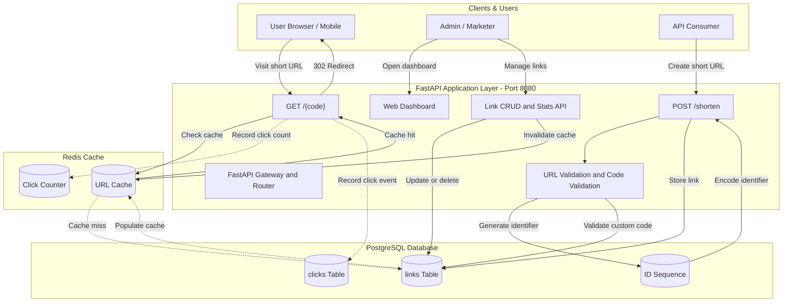
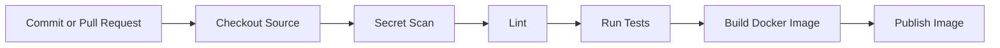

# 🔗 URL Shortener & Click Analytics Platform

[](https://www.python.org/)
[](https://fastapi.tiangolo.com/)
[](https://www.postgresql.org/)
[](https://redis.io/)
[](https://www.docker.com/)
[](https://kubernetes.io/)
[](https://circleci.com/)
[](https://docs.pytest.org/)

A containerized URL Shortener and Click Analytics Platform built with Python, FastAPI, PostgreSQL, and Redis. The project provides short URL generation, redirects, click tracking, a web dashboard, Docker Compose support, automated CI/CD with CircleCI, and Kubernetes deployment configurations.

---

## 🚀 Application Overview

### What is this application?

The **URL Shortener & Click Analytics Platform** transforms long URLs into short, memorable, and shareable links.

For example:

- Original URL: `https://docs.docker.com/engine/`
- Short URL: `http://localhost:8080/docker`

When someone visits a short link, the application redirects them to the original destination. It can also record click information, such as timestamps and HTTP Referer headers, for analytics.

### Why was it built? (Problem & Solution)

1. **Fast redirects**
   - Problem: Repeated database queries can slow down redirects.
   - Solution: Redis caching can reduce database access for cached links.

2. **Click analytics**
   - Problem: Users need to understand how often their links are visited.
   - Solution: Record click events and provide statistics by date and referrer.

3. **Collision prevention**
   - Problem: Concurrent requests may attempt to create identical short codes.
   - Solution: PostgreSQL sequences and database uniqueness constraints help prevent duplicate codes.

4. **Interactive web dashboard**
   - Problem: Managing links through terminal commands is inconvenient.
   - Solution: Provide a dashboard for shortening URLs, listing links, editing destinations, deleting links, and viewing statistics.

5. **Cloud-native DevOps**
   - Problem: Applications need consistent build, test, and deployment processes.
   - Solution: Use Docker, Docker Compose, CircleCI, and Kubernetes to support development and deployment workflows.

---

## 🏛️ System Architecture & Data Flow



### Runtime Configuration

| Setting | Value |
|---|---|
| Runtime | Python 3.12 |
| Framework | FastAPI |
| Application server | Uvicorn |
| Application port | 8080 |
| Database | PostgreSQL |
| Cache | Redis |
| Environment variables | `DATABASE_URL`, `REDIS_URL` |
| Dependencies | PostgreSQL, Redis, and database migrations |

---

## ✨ Core Features

| Feature | Description |
|---|---|
| **URL Shortening** | Converts long URLs into short codes. |
| **Custom Aliases** | Supports memorable custom codes when enabled by the application. |
| **Fast Redirects** | Uses Redis caching when configured. |
| **Click Analytics** | Tracks click events and referrer information when implemented. |
| **Web Dashboard** | Provides an interface for managing links. |
| **REST API** | Exposes endpoints for URL creation and link management. |
| **URL Validation** | Validates submitted URLs before processing. |
| **Docker Support** | Packages the application into a container. |
| **Docker Compose** | Runs the application and its supporting services together. |
| **Kubernetes** | Supports deployment through Kubernetes manifests. |
| **CircleCI** | Automates configured build and testing steps. |

---

## 🛠️ Technology Stack

| Layer | Technology | Purpose |
|---|---|---|
| Programming Language | Python 3.12 | Application logic |
| Web Framework | FastAPI | HTTP APIs and web application |
| ASGI Server | Uvicorn | Runs the FastAPI application |
| Database | PostgreSQL 16 | Persistent storage |
| Cache | Redis 7 | Cached URL lookups and counters |
| Containerization | Docker | Packages the application |
| Local Orchestration | Docker Compose | Runs multiple services |
| CI/CD | CircleCI | Automated validation and build workflows |
| Testing | Pytest | Automated tests |
| Code Quality | Ruff | Python linting |
| Conta  iner Orchestration | Kubernetes | Deploys and manages containers |

---

## 📱 Interactive Web Dashboard

When the application is running, open:

`http://localhost:8080/`

If the dashboard is implemented and enabled, it can provide an interface for:

1. **Shorten URL:** Enter a destination URL and generate a short link.
2. **View Links:** Browse previously created links.
3. **View Analytics:** Inspect click statistics.
4. **Edit Links:** Update a destination URL.
5. **Delete Links:** Remove links that are no longer required.

The available dashboard features depend on the application's current implementation.

---

## 🔌 API Reference

The following endpoints describe the intended API structure. Verify each endpoint against the actual application routes before relying on it.

| Method | Endpoint | Purpose |
|---|---|---|
| `GET` | `/` | Web dashboard |
| `GET` | `/health` | Health check |
| `POST` | `/shorten` | Create a short URL |
| `GET` | `/{code}` | Redirect to the original URL |
| `GET` | `/api/links` | List links |
| `PUT` | `/api/links/{code}` | Update a link |
| `DELETE` | `/api/links/{code}` | Delete a link |
| `GET` | `/api/links/{code}/stats` | Retrieve click statistics |

### Sample API Commands

#### 1. Health Check

```bash
curl -i http://localhost:8080/health
```

#### 2. Shorten a URL

```bash
curl -i -X POST http://localhost:8080/shorten \
  -H "Content-Type: application/json" \
  -d '{"url":"https://docs.docker.com/engine/"}'
```

#### 3. Follow a Short Link

Replace `YOUR_CODE` with a code returned by the application.

```bash
curl -i http://localhost:8080/YOUR_CODE
```

#### 4. Retrieve Click Statistics

Replace `YOUR_CODE` with a valid short code.

```bash
curl -i http://localhost:8080/api/links/YOUR_CODE/stats
```

#### 5. Update a Short Link

```bash
curl -i -X PUT http://localhost:8080/api/links/YOUR_CODE \
  -H "Content-Type: application/json" \
  -d '{"url":"https://kubernetes.io/docs/"}'
```

#### 6. Delete a Short Link

```bash
curl -i -X DELETE http://localhost:8080/api/links/YOUR_CODE
```

**Note:** These sample commands assume the listed routes exist in your application. An HTTP error may indicate that a route is unavailable or that the request format differs from the implementation.

---

## ⚡ Concurrency and Collision Prevention

### The Challenge

When multiple users create short URLs simultaneously, each generated short code must remain unique.

### Auto-Generated Codes

A common approach is to use PostgreSQL-generated identifiers and encode them into short strings.

1. PostgreSQL generates unique identifiers using a sequence.
2. The application encodes the identifier into a short code.
3. The database enforces uniqueness on the code column.

This approach helps prevent collisions for automatically generated codes, provided the implementation uses the identifier and encoding correctly.

### Custom Codes

When two users request the same custom alias, the database should enforce a unique constraint.

For example:

```sql
CREATE UNIQUE INDEX links_code_unique
ON links (code);
```

The application should handle uniqueness violations and return an appropriate response, such as HTTP `409 Conflict`.

The exact database constraint must match the existing schema and application logic. Do not create this index again if an equivalent unique constraint already exists.

---

## 🚦 Quickstart: Running Locally

### Prerequisites

- Git
- Docker Desktop
- Docker Compose v2 or later

Python is not required on your host machine when all application dependencies are installed and the application runs entirely inside Docker containers.

### 1. Clone the Repository

```bash
git clone https://github.com/nikhil1403621/url-shortener-python.git
cd url-shortener-python
```

If your project files are inside a nested directory named `url shortner`, enter it:

```bash
cd "url shortner"
```

### 2. Start the Application

Check which Compose file exists:

```bash
ls
```

Then run:

```bash
docker compose up --build -d
```

This command builds the configured images and starts the services in the background.

### 3. Check Running Services

```bash
docker compose ps
```

### 4. Inspect Application Logs

```bash
docker compose logs --tail=50
```

### 5. Check Application Health

If the application exposes the health endpoint:

```bash
curl -i http://localhost:8080/health
```

### 6. Open the Dashboard

Visit:

`http://localhost:8080/`

Use the port mapping defined in your Compose configuration if it differs from port 8080.

---

## 🧪 Testing and Code Quality

### 1. Run Unit Tests

If Python and the project dependencies are installed locally:

```bash
pytest
```

Or run tests inside the configured application container:

```bash
docker compose exec app pytest
```

Replace `app` with the actual application service name from your Compose file.

### 2. Run Tests with Coverage

If `pytest-cov` is installed:

```bash
pytest --cov=app --cov-report=term-missing
```

To enforce a coverage threshold:

```bash
pytest --cov=app --cov-report=term-missing --cov-fail-under=70
```

### 3. Run Static Analysis

If Ruff is installed:

```bash
ruff check .
```

### 4. Integration Tests

Integration tests may require PostgreSQL and Redis to be running.

Start the configured services:

```bash
docker compose up -d
```

Then run the relevant integration test files defined in the repository.

Test counts and coverage percentages should be updated to reflect actual test results. Do not claim a particular coverage percentage until the tests confirm it.

---

## 🔄 CI/CD Pipeline with CircleCI

The CircleCI configuration is stored in:

`.circleci/config.yml`

A typical CI pipeline can run these stages:



The actual jobs and stages depend on the configuration committed to the repository.

### Verify the Pipeline

1. Commit and push your changes to GitHub.
2. Open https://app.circleci.com/.
3. Select the `url-shortener-python` project.
4. Open the Pipelines page.
5. Select the pipeline triggered by your latest commit.
6. Open the job and review its output.

A successful pipeline should show a passing status for every required job.

### Branch Workflow

A possible branch workflow is:

- `main`: primary development or QA branch.
- `staging`: staging validation.
- `prod`: production release branch.

Configure these environments according to your repository's actual branch rules and CircleCI workflow. The branch names alone do not guarantee automatic deployments.

---

## ☸️ Kubernetes Multi-Namespace Deployment

Kubernetes manifests are maintained in the `k8s/` directory when included in the repository.

Example environments:

| Namespace | Purpose |
|---|---|
| `qa` | Quality assurance testing |
| `stage` | Staging validation |
| `prod` | Production deployment |

The configured namespaces, image tags, replicas, probes, and services must match the actual Kubernetes manifests.

### 1. Check the Kubernetes Cluster

If using Minikube:

```bash
minikube status
```

Start it if required:

```bash
minikube start
```

### 2. List Pods in All Namespaces

```bash
kubectl get pods -A
```

### 3. List Deployments

```bash
kubectl get deployments -A
```

### 4. List Services

```bash
kubectl get services -A
```

### 5. Check the Application Namespace

For the `stage` namespace:

```bash
kubectl get pods -n stage
kubectl get deployments -n stage
kubectl get services -n stage
```

### 6. Check Deployment Rollout

If the Deployment is named `url-shortener-app`:

```bash
kubectl rollout status deployment/url-shortener-app -n stage
```

If the name differs, use the Deployment name shown by `kubectl get deployments -n stage`.

### 7. Deploy the Application

If the repository contains a setup script:

```bash
./k8s/setup-k8s.sh
```

Inspect the script and its prerequisites before executing it. It must exist and be configured for your cluster.

### 8. Inspect a Failing Pod

```bash
kubectl describe pod POD_NAME -n stage
kubectl logs POD_NAME -n stage
```

Replace `POD_NAME` with the real pod name.

A deployment is ready when its desired replicas are available and its rollout completes successfully. Verify application functionality separately using the appropriate service or ingress.

---

## 💬 Frequently Asked Architectural Questions

### Q1. Why use a Kubernetes Deployment instead of a standalone Pod?

A Deployment manages ReplicaSets and helps maintain the desired number of application replicas. It supports replacement of failed Pods, rolling updates, and rollbacks.

### Q2. Why use `postgres` in Docker Compose instead of `localhost`?

Inside a Compose application container, `localhost` refers to that same container. Compose services can communicate through the Compose network using service names such as `postgres` and `redis`.

The correct database hostname depends on where the application is running.

### Q3. What happens if a Pod managed by a Deployment is deleted?

The Kubernetes controller detects that the actual replica count is below the desired count and attempts to create a replacement Pod.

### Q4. Why run Docker containers as a non-root user?

Running as a non-root user follows the principle of least privilege and can reduce the impact of some security vulnerabilities.

### Q5. What does `kubectl rollout restart` do?

It triggers a new rollout of a Deployment's Pods. It does not rebuild the Docker image. The replacement Pods use the image and pull policy specified in the Deployment configuration.

---

## 📄 License

This project is licensed under the MIT License, provided the repository includes the corresponding MIT license text.

