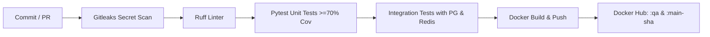

# 🔗 URL Shortener & Click Analytics Platform

[](https://www.python.org/)
[](https://fastapi.tiangolo.com/)
[](https://www.postgresql.org/)
[](https://redis.io/)
[](https://www.docker.com/)
[](https://kubernetes.io/)
[](https://circleci.com/)
[](https://docs.pytest.org/)

A high-performance, enterprise-ready, containerized **URL Shortener and Real-Time Click Analytics Platform** engineered with Python (FastAPI), PostgreSQL 16, and Redis 7. Features sub-millisecond cached redirects, mathematical collision-proof encoding, an interactive glassmorphic web dashboard, automated CI/CD branch promotion, and multi-namespace Kubernetes orchestration.

---

## 🚀 Application Overview

### What is this application?
The **URL Shortener & Click Analytics Platform** transforms long, cumbersome, parameter-laden URLs (e.g., campaign tracking links, complex documentation links) into clean, memorable, and shareable short codes (e.g., `https://short.ly/docker` or auto-generated Base-58 keys like `https://short.ly/2K7`).

When users visit a short link, the application immediately redirects them to the target destination while capturing telemetry data—including timestamps and HTTP Referer headers—to generate real-time analytics reports.

### Why was it built? (Problem & Solution)
1. **Sub-Millisecond Redirect Latency**: 
   - *Problem*: Traditional URL shorteners query a relational database on every single redirect, creating a major I/O bottleneck under viral traffic surges.
   - *Solution*: A dual-tier caching architecture where **Redis serves all 302 redirects in under 2ms**. PostgreSQL is never queried on the hot path for cached links.
2. **Attribution & Real-Time Analytics**:
   - *Problem*: Marketing campaigns and shared links require precise, tamper-free attribution to determine which channels (e.g., Twitter, LinkedIn, email, or direct) drive traffic.
   - *Solution*: Every redirect captures referrer information and logs time-series click events, aggregated in real time by day and referral source.
3. **Collision-Proof Concurrency ("The Hard Part")**:
   - *Problem*: When thousands of users shorten URLs at the exact same millisecond, race conditions can cause duplicate codes or attribution leakage.
   - *Solution*: A mathematically proven Base-58 bijective mapping over PostgreSQL atomic sequences for auto-generated codes, paired with ACID unique constraints for custom codes, eliminating Time-of-Check to Time-of-Use (TOCTOU) race conditions.
4. **Interactive Web Management Dashboard**:
   - *Problem*: Developers and non-technical team members often lack intuitive tools to manage links without raw terminal commands or API clients.
   - *Solution*: A built-in, responsive dark-mode web dashboard (`/`) providing single-click URL shortening, live link listings, click statistics inspection, in-place URL editing, and safe deletion.
5. **Production-Grade Cloud-Native DevOps**:
   - *Problem*: Moving an application from local development to production often results in configuration drift, permission risks, and downtime.
   - *Solution*: Packaged into an unprivileged Docker container, orchestrated via Docker Compose, validated by an automated CircleCI pipeline (Gitleaks, Ruff, Pytest >93% coverage, integration tests), and deployed to isolated Kubernetes namespaces (`qa`, `stage`, `prod`) with zero-downtime rolling updates.

---

## 🏛️ System Architecture & Data Flow

```mermaid
flowchart TD
    subgraph Clients["Clients & Users"]
        Browser["User Browser / Mobile"]
        Admin["Admin / Marketer (Dashboard)"]
        APIClient["API Consumer (curl / SDK)"]
    end

    subgraph AppLayer["FastAPI Application Layer (Port 8080)"]
        Router["FastAPI Gateway & Router"]
        Dashboard["Interactive Web UI Dashboard (/)"]
        ShortenAPI["Shorten Controller (POST /shorten)"]
        RedirectAPI["Hot Path Redirector (GET /{code})"]
        CRUDAPI["Link CRUD & Stats API (/api/links)"]
        Security["SSRF Guard & Base-58 Sanitizer"]
    end

    subgraph CacheLayer["In-Memory Cache (Redis 7)"]
        RedisLinkCache[("Redis Key-Value Cache<br/>link:{code} -> target URL (1h TTL)")]
        RedisCounter[("Atomic Click Counter<br/>clicks:{code}")]
    end

    subgraph DataLayer["Relational Storage (PostgreSQL 16)"]
        PGSeq[("Monotonic ID Sequence<br/>SERIAL PRIMARY KEY")]
        LinksTable[("links Table<br/>id, code (UNIQUE), url, created_at")]
        ClicksTable[("clicks Table<br/>id, link_id (FK CASCADE), clicked_at, referrer")]
    end

    %% Client Interactions
    Browser -->|GET /{code}| RedirectAPI
    Admin -->|GET /| Dashboard
    APIClient -->|POST /shorten| ShortenAPI
    Admin -->|PUT / DELETE / Stats| CRUDAPI

    %% Hot Path Logic
    RedirectAPI -->|1. Check Cache| RedisLinkCache
    RedisLinkCache -->|Cache HIT (<2ms)| RedirectAPI
    RedirectAPI -->|302 Redirect + Referer| Browser
    RedirectAPI -.->|Async Increment| RedisCounter
    RedirectAPI -.->|Log Click Event| ClicksTable
    RedisLinkCache -.->|Cache MISS| LinksTable
    LinksTable -.->|Populate Cache| RedisLinkCache

    %% Shorten & Validation Logic
    ShortenAPI --> Security
    Security -->|Auto-Generate| PGSeq
    PGSeq -->|Atomic ID| ShortenAPI
    ShortenAPI -->|Base-58 Bijection| LinksTable
    Security -->|Custom Code| LinksTable

    %% Management & Invalidation
    CRUDAPI -->|Update / Delete| LinksTable
    CRUDAPI -->|Purge Key| RedisLinkCache
```

---

## ✨ Core Features

| Feature | Description | Benefit |
|---|---|---|
| **⚡ High-Speed 302 Redirects** | Redirects serviced directly from Redis key-value storage with 1-hour TTL. | Sub-millisecond redirect latency; shields PostgreSQL from traffic spikes. |
| **🔢 Base-58 Bijective Encoding** | Monotonically increasing 64-bit integer IDs mapped via a strict bijection over a 58-character alphanumeric alphabet. | Mathematically impossible to produce duplicate auto-generated codes. |
| **🎯 Custom Vanity Aliases** | Allows users to create memorable custom codes (e.g., `/welcome`, `/docker`, `/promo2026`). | Clean marketing links and high user recall. |
| **🛡️ Concurrency & TOCTOU Defense** | PostgreSQL database-level unique index (`CREATE UNIQUE INDEX links_code ON links (code)`). | Concurrent identical custom requests cleanly return HTTP 409 Conflict without data corruption. |
| **📊 Real-Time Click Telemetry** | Captures timestamp, destination, and HTTP `Referer` headers on every visit. | Granular insights into 30-day daily click trends and top referrer domains. |
| **🖥️ Interactive Web UI Dashboard** | Modern, responsive dark-mode management interface available directly at `GET /`. | Manage links, edit destinations, view analytics, and test redirects visually without external tools. |
| **🔄 Full RESTful CRUD API** | Standardized JSON endpoints for Link Creation (`POST`), Retrieval (`GET`), Updating (`PUT`), and Deletion (`DELETE`). | Seamless integration with external services, mobile apps, and developer scripts. |
| **🔒 Enterprise Security & SSRF Guard** | Host-based filtering rejecting loopback (`127.0.0.1`), private RFC1918 subnets, and cloud metadata IPs (`169.254.169.254`). | Prevents Server-Side Request Forgery and internal network probing. |
| **🐳 Containerized & Non-Root** | Alpine/Bookworm multi-stage Docker build running under an unprivileged `appuser`. | Defense-in-depth against container breakout exploits. |
| **☸️ Multi-Namespace Kubernetes** | Dedicated declarative manifests for `qa`, `stage`, and `prod` environments with rolling updates and health probes. | Production-grade high availability, self-healing, and environment isolation. |

---

## 🛠️ Technology Stack

| Layer | Technology | Version | Purpose |
|---|---|---|---|
| **Language** | Python | 3.12.8 | Asynchronous core application runtime |
| **Web Framework** | FastAPI | 0.111.0 | High-performance ASGI REST API and dashboard server |
| **ASGI Server** | Uvicorn | 0.30.1 | Production-ready ASGI web server |
| **Primary Database** | PostgreSQL | 16-alpine | Relational persistence with ACID transactions and sequences |
| **Cache & Buffering** | Redis | 7-alpine | In-memory key-value cache and real-time counter |
| **Database Driver** | psycopg2-binary | 2.9.9 | Low-overhead PostgreSQL client |
| **Containerization** | Docker & Compose | v2+ | Multi-stage image build and multi-service local orchestration |
| **CI/CD Platform** | CircleCI | 2.1 | Automated secret scanning, linting, unit & integration tests, image push |
| **Container Security** | Gitleaks | Latest | Static code secret and token scanning |
| **Linter / Formatter** | Ruff | 0.4.10 | Blazing-fast static analysis and PEP 8 enforcement |
| **Test Runner** | Pytest & pytest-cov | 8.2.2 / 5.0.0 | Unit tests (152 tests, >93% coverage) and integration tests |
| **Orchestration** | Kubernetes | 1.28+ | Multi-namespace deployments (`qa`, `stage`, `prod`), rolling updates |

---

## 📱 Interactive Web Dashboard

When running the application, visit **`http://localhost:8080/`** to access the interactive web management dashboard:

1. **Shorten URL Card**: Enter any valid target URL and optionally specify a custom alias. Click **"Shorten URL"** to generate the link instantly.
2. **Active Links Table**: Displays all registered short codes, destination URLs, creation timestamps, and live click tallies.
3. **Analytics Modal**: Click **"Stats"** next to any link to view a visual breakdown of **Clicks Per Day** and **Top Referrers**.
4. **Edit Destination Modal**: Click **"Edit"** to update an existing short link's target URL in real time with automatic cache invalidation.
5. **Delete Confirmation**: Click **"Delete"** to remove a link, cascade-delete associated click records, and purge the Redis cache.

---

## 🔌 API Reference & Endpoints

| Method | Endpoint | Description | Status Codes |
|---|---|---|---|
| `GET` | `/` | Interactive Web UI Dashboard | `200 OK` |
| `GET` | `/health` | Health check for PostgreSQL and Redis connectivity | `200 OK`, `503 Service Unavailable` |
| `POST` | `/shorten` | Create short URL (auto-generated or custom alias) | `201 Created`, `400 Bad Request`, `409 Conflict` |
| `GET` | `/{code}` | **Hot Path**: Redirects to target URL, increments click counter | `302 Found`, `404 Not Found` |
| `GET` | `/api/links` | List recent short links with click counts | `200 OK` |
| `PUT` | `/api/links/{code}` | Update the destination URL of an existing link | `200 OK`, `400 Bad Request`, `404 Not Found` |
| `DELETE` | `/api/links/{code}` | Delete link, cascade-delete clicks, purge Redis cache | `200 OK`, `404 Not Found` |
| `GET` | `/api/links/{code}/stats` | Retrieve click statistics: clicks per day & top referrers | `200 OK`, `404 Not Found` |

### Sample `curl` Commands

#### 1. Health Check
```bash
curl -s http://localhost:8080/health
```
```json
{"status":"ok","postgres":true,"redis":true}
```

#### 2. Shorten a URL (Auto-Generated Code)
```bash
curl -s -X POST http://localhost:8080/shorten \
  -H "Content-Type: application/json" \
  -d '{"url": "https://docs.docker.com/engine/"}'
```
```json
{"code":"4","url":"https://docs.docker.com/engine/","short":"/4"}
```

#### 3. Shorten a URL (Custom Vanity Alias)
```bash
curl -s -X POST http://localhost:8080/shorten \
  -H "Content-Type: application/json" \
  -d '{"url": "https://kubernetes.io/docs/", "custom": "k8s-docs"}'
```
```json
{"code":"k8s-docs","url":"https://kubernetes.io/docs/","short":"/k8s-docs"}
```

#### 4. Follow Redirect & Track Click
```bash
curl -s -I -H "Referer: https://twitter.com" http://localhost:8080/k8s-docs
```
```http
HTTP/1.1 302 Found
location: https://kubernetes.io/docs/
```

#### 5. Inspect Click Analytics
```bash
curl -s http://localhost:8080/api/links/k8s-docs/stats
```
```json
{
  "code": "k8s-docs",
  "url": "https://kubernetes.io/docs/",
  "per_day": [{"day": "2026-10-17", "clicks": 1}],
  "referrers": [{"referrer": "https://twitter.com", "clicks": 1}]
}
```

#### 6. Update Target URL
```bash
curl -s -X PUT http://localhost:8080/api/links/k8s-docs \
  -H "Content-Type: application/json" \
  -d '{"url": "https://kubernetes.io/docs/home/"}'
```

#### 7. Delete Link
```bash
curl -s -X DELETE http://localhost:8080/api/links/k8s-docs
```

---

## ⚡ Concurrency & Collision Prevention ("The Hard Part")

### The Challenge
> Two people shortening the same URL at the same moment must not get the same code. Decide whether identical URLs share a code or get separate ones, and make the collision impossible either way.

### Architectural Decision: Independent Codes per Request
Identical URLs are intentionally assigned **separate short codes**:
- **Attribution Isolation**: In analytics and campaign attribution, User A (Marketing team running a LinkedIn campaign) and User B (Sales team emailing a client) need independent tracking even if sharing the same destination URL. Sharing codes would pollute telemetry and invalidate conversion tracking.

### Mathematical & Architectural Collision Proof

#### 1. Auto-Generated Codes (Atomic Sequences + Strict Bijection)
- When a URL is submitted without a custom alias, PostgreSQL executes:
  ```sql
  INSERT INTO links (code, url) VALUES ('', %s) RETURNING id;
  ```
- PostgreSQL allocates a 64-bit integer `id` from an atomic sequence (`SERIAL`).
- Sequence allocations in PostgreSQL are **lock-free, transactional, and engine-level atomic**. Even under millions of concurrent requests across multiple app instances, no two transactions can ever receive the identical `id`.
- The short code is calculated using `encode(id)` with a Base-58 alphabet (`23456789abcdefghijkmnpqrstuvwxyzABCDEFGHJKLMNPQRSTUVWXYZ`), excluding visually ambiguous characters (`0`, `O`, `I`, `l`).
- Base-58 encoding is a **strict mathematical bijection** ($f: \mathbb{N}^+ \to \Sigma^*$):
  $$\forall a, b \in \mathbb{N}^+: a \neq b \implies \text{encode}(a) \neq \text{encode}(b)$$
- **Result:** Collisions on auto-generated codes are mathematically impossible.

#### 2. Custom Codes (ACID Constraints vs. TOCTOU Race Conditions)
- If two users submit the same custom alias (`summer-sale`) simultaneously:
  - Checking availability via `SELECT 1 FROM links WHERE code = %s` is vulnerable to a classic **TOCTOU (Time-of-Check to Time-of-Use)** race condition where both requests observe the code as available before either commits.
  - To eliminate this, PostgreSQL enforces a database-level unique index:
    ```sql
    CREATE UNIQUE INDEX links_code ON links (code) WHERE code <> '';
    ```
  - The second concurrent transaction triggers an atomic `UniqueViolation`.
  - The application intercepts this error and returns a clean `HTTP 409 Conflict` (`'code' is already taken`).
- **Result:** Custom code collisions are physically blocked at the storage engine level.

---

## 🚦 Quickstart: Running Locally

### Prerequisites
- Docker Engine 24+ & Docker Compose v2+
- Git

### 1. Clone & Start the Stack
```bash
git clone https://github.com/nikhil1403621/url-shortener-python.git
cd url-shortener-python/"url shortner"

# Start application, PostgreSQL, Redis, and run migrations
docker compose up --build -d
```

### 2. Verify Health
```bash
curl -s http://localhost:8080/health
```
```json
{"status":"ok","postgres":true,"redis":true}
```

### 3. Open the Web Dashboard
Navigate your browser to:
```
http://localhost:8080/
```

---

## 🧪 Testing & Code Quality

The repository includes a comprehensive two-tier test suite:

### 1. Unit Tests (`tests/test_codes.py`, `tests/test_app_unit.py`)
- **152 unit tests** covering Base-58 encoding/decoding, reserved keyword rejection, SSRF IP defense, URL normalisation, and mock controller actions.
- Zero network or database overhead (runs in < 1 second).
- **Code coverage exceeds 93%** (exceeding the 70% CI gate requirement).

```bash
pytest tests/test_codes.py tests/test_app_unit.py --cov=app --cov-report=term-missing --cov-fail-under=70
```

### 2. Integration Tests (`tests/test_integration.py`)
- Runs 10 end-to-end integration tests against real PostgreSQL 16 and Redis 7 containers.
- Validates migrations, database writes, Redis redirect caching, update workflows, cascading deletes, and analytics aggregations.

```bash
pytest tests/test_integration.py
```

### 3. Static Analysis
```bash
ruff check .
```

---

## 🔄 CI/CD Pipeline (CircleCI)

The automated pipeline defined in `.circleci/config.yml` implements enterprise quality gates:



### Workflow Rules by Branch:
1. **`main` (QA Environment)**:
   - Executes Secret Scan &rarr; Ruff Lint &rarr; Unit Tests &rarr; Integration Tests &rarr; Build & Push.
   - Pushes moving tag `:qa` and immutable tag `:main-<short-sha>` plus `:1.0`.
2. **`staging` (Staging Environment)**:
   - Build-only workflow pushing `:stage` and `:staging-<short-sha>`.
3. **`prod` (Production Environment)**:
   - Build-only workflow pushing `:prod` and `:prod-<short-sha>` plus `:1.0`.

### Protected Branch Ruleset
Promotion strictly follows:
$$\text{feature/<name>} \xrightarrow{\text{PR}} \text{main (QA)} \xrightarrow{\text{PR}} \text{staging} \xrightarrow{\text{PR}} \text{prod}$$
- Block force pushes, restrict branch deletions, and enforce pull requests with merge commits.

---

## ☸️ Kubernetes Multi-Namespace Deployment

Kubernetes manifests are organized under `k8s/` for three isolated namespaces:

| Namespace | Image Tag | ImagePullPolicy | Replicas | Health Probes |
|---|---|---|---|---|
| **`qa`** | `nikhil1403621/url-shortener-python:qa` | `Always` | 1 | `/health` (Liveness & Readiness) |
| **`stage`** | `nikhil1403621/url-shortener-python:stage` | `Always` | 1 | `/health` (Liveness & Readiness) |
| **`prod`** | `nikhil1403621/url-shortener-python:prod` | `Always` | 1 | `/health` (Liveness & Readiness) |

### Deploy Stack to Kubernetes
```bash
./k8s/setup-k8s.sh
```

### Rolling Update & Digest Verification Demo
```bash
./k8s/rollout-demo.sh
```

---

## 💬 Frequently Asked Architectural Questions

### Q1: Why is this deployed as a Deployment and not a standalone Pod?
> **Answer:** A Pod is an ephemeral, unmanaged instance. If a standalone Pod crashes or its worker node fails, it is terminated permanently. A Kubernetes **Deployment** manages an underlying **ReplicaSet**, ensuring declarative state management, automatic self-healing (recreating failed pods), zero-downtime rolling updates, and easy rollback capabilities.

### Q2: Why does integration testing talk to `localhost` in CircleCI but to `postgres` in Docker Compose?
> **Answer:** In Docker Compose, each container runs in its own network namespace on a bridge network; Compose provisions an internal DNS server that resolves service names (`postgres`, `redis`) to their container IPs. In CircleCI, primary and secondary service containers share the **same network namespace** (`localhost`); all exposed ports map directly to `localhost:5432` and `localhost:6379`.

### Q3: What happens if a Pod is manually deleted?
> **Answer:** Because the Pod is owned by a Deployment controller, the ReplicaSet control loop detects `current_replicas (0) < desired_replicas (1)` and immediately provisions a replacement Pod to restore the desired state.

### Q4: Why does the Dockerfile create an unprivileged user instead of running as root?
> **Answer:** Defense-in-depth and the Principle of Least Privilege. Running as root inside a container means that any remote code execution (RCE) or container escape vulnerability immediately grants root privileges on the underlying host kernel. Using an unprivileged user (`appuser` with `/sbin/nologin`) minimizes the attack surface.

### Q5: What does `kubectl rollout restart` actually do?
> **Answer:** It does **not** rebuild the Docker image. Instead, it updates a timestamp annotation (`kubectl.kubernetes.io/restartedAt`) in the Deployment's Pod template. This triggers the Deployment controller to perform a rolling update: pulling the latest image tag from Docker Hub (ensured by `imagePullPolicy: Always`) and launching fresh Pods while gracefully terminating old ones.

---

## 📄 License
This project is licensed under the MIT License.
